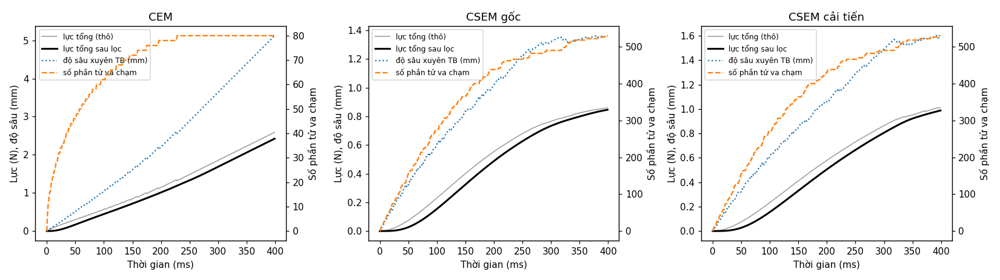
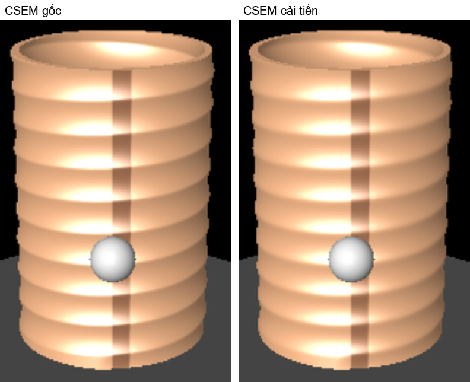

# Haptic Pottery — bài tập 5

Mô phỏng nặn gốm ảo có phản hồi lực trên CHAI3D 3.3.0. Làm đủ cả 3 mức:

| Mức | Mô hình | Trạng thái |
|---|---|---|
| 1 | CEM [1]: cột phần tử hình trụ, biến dạng đối xứng trụ | xong |
| 2 | CSEM [2]: lưới phần tử hình quạt, biến dạng cục bộ, nặn được lòng gốm, lọc lực 10 Hz | xong |
| 3 | CSEM cải tiến: làm mượt Laplace cục bộ quanh HIP, chỉ cập nhật các hàng mesh bị đổi | xong, có số đo |

**Video:** _(chèn link)_

Mục lục: [Chạy ngay](#chạy-ngay) · [Kết quả đo](#kết-quả-đo) · [Build từ source](#build-từ-source) · [Tham số chính](#tham-số-chính) · [Cấu trúc code](#cấu-trúc-code) · [Code dùng lại](#code-dùng-lại-từ-nguồn-ngoài)

## Chạy ngay

`bin/haptic-pottery.exe` là bản build sẵn cho Windows 10/11 64-bit. File này link tĩnh, không cần cài thêm gì, chạy được trên mọi CPU x86-64.

```
haptic-pottery.exe          chạy tương tác
haptic-pottery.exe auto     tự chạy 3 test Mục 5.1 + 9 benchmark Mục 5.2 rồi thoát (~1,5 phút)
haptic-pottery.exe tests    chỉ chạy 3 test Mục 5.1 rồi thoát
```

Không cắm thiết bị thì chương trình tự chuyển sang HIP ảo, điều khiển bằng bàn phím. Chế độ `auto` và `tests` ghi CSV/PNG vào thư mục hiện tại. Vẽ lại đồ thị Mục 5.1: `python tools/plot_force.py force_log_CSEM.csv`.

| Phím | Chức năng |
|---|---|
| `1` / `2` / `3` | CEM / CSEM gốc / CSEM cải tiến |
| `N` | đổi độ phân giải CSEM: 200×180, 200×360, 400×360, 800×360 |
| `R` | reset gốm về hình trụ |
| `SPACE` (hoặc nút 0 trên Falcon) | bàn xoay quay/dừng |
| `W` / `S` | tăng/giảm tốc độ bàn xoay |
| `[` / `]` | giảm/tăng bán kính HIP |
| `L` | bật/tắt bộ lọc lực |
| `V` | đổi thiết bị thật ↔ HIP ảo |
| Mũi tên, `PageUp`/`PageDown` | di chuyển HIP ảo |
| `T` | test Mục 5.1: HIP tự ấn vào gốm 400 ms, ghi `force_log_<model>.csv` |
| `B` | benchmark Mục 5.2 cho mô hình đang chọn: HIP tự đi từ miệng xuống đáy khi bàn quay, ghi `benchmark.csv` và ảnh gốm |
| `Shift+B` | chạy benchmark cho mọi mô hình × mọi độ phân giải |
| `P` | chụp màn hình |
| `F` / `Q`, `ESC` | toàn màn hình / thoát |

**Dùng Novint Falcon trên Windows:** gỡ phần mềm Novint, cài Force Dimension SDK 64-bit, để `dhd64.dll` cạnh file exe hoặc trong `PATH` (CHAI3D nạp DLL này lúc chạy, không cần build lại). Nếu Windows không nhận Falcon, vào Device Manager chọn tay driver Force Dimension.

## Kết quả đo

**Môi trường đo:** Intel Core i7-13650HX, 32 GB RAM, RTX 4060 Laptop, Windows 11, MinGW-w64 GCC 14.2 `-O3`, bản exe trong `bin/`. Chưa có Falcon nên mọi số đo dùng HIP ảo đi theo quỹ đạo lập trình sẵn (đúng như đề cho phép). Khi không có thiết bị, vòng haptic tự giữ nhịp 1 kHz giống Falcon. Mỗi số trong bảng là trung vị của 3 lần chạy `haptic-pottery.exe auto`.

### Mục 5.1: lực, độ sâu và số phần tử va chạm

HIP ấn chậm theo phương bán kính, sâu dần tới 6 mm trong 400 ms, bàn xoay đứng yên.



| Mô hình | Phần tử va chạm lúc cuối | Lực sau lọc lúc cuối | Dao động của lực thô | Dao động của lực sau lọc |
|---|---:|---:|---:|---:|
| CEM 600×90 | 80 | 2,42 N | 6,01 mN | 0,049 mN (giảm 122 lần) |
| CSEM gốc 200×360 | 530 | 0,85 N | 0,58 mN | 0,020 mN (giảm 28 lần) |
| CSEM cải tiến 200×360 | 530 | 0,99 N | 0,79 mN | 0,021 mN (giảm 38 lần) |

"Dao động" là RMS của sai phân bậc hai giữa các vòng haptic liên tiếp. Chỉ số này đo phần giật nhanh của lực, bỏ qua phần tăng đều theo độ sâu. Số phần tử va chạm của CSEM nhảy trung bình 1,3 phần tử mỗi vòng, nhưng lực sau lọc vẫn tăng đều khi HIP ấn sâu hơn, đúng như Hình 6 của đề.

### Mục 5.2: hiệu năng vòng haptic

Quỹ đạo: HIP đi từ miệng gốm xuống đáy trong 10 s, ăn sâu cố định 2 mm, bàn xoay 1 vòng/giây. Đây cũng là thao tác tạo Hình 4 trong [3].

| Mô hình | Lưới | Phần tử | Thời gian tính một vòng haptic TB / min / max (ms) | Tần số haptic TB / thấp nhất (Hz) |
|---|---|---:|---:|---:|
| CEM | 600×90 | 54.000 | 0,0005 / 0,0000 / 0,016 | 1000 / 914 |
| CSEM gốc | 200×180 | 36.000 | 0,0025 / 0,0001 / 0,036 | 1000 / 871 |
| CSEM gốc | 200×360 | 72.000 | 0,0047 / 0,0001 / 0,031 | 1000 / 914 |
| CSEM gốc | 400×360 | 144.000 | 0,0091 / 0,0001 / 0,154 | 1000 / 893 |
| CSEM gốc | 800×360 | 288.000 | 0,0177 / 0,0001 / 0,138 | 1000 / 858 |
| CSEM cải tiến | 200×180 | 36.000 | 0,0048 / 0,0001 / 0,086 | 1000 / 924 |
| CSEM cải tiến | 200×360 | 72.000 | 0,0082 / 0,0001 / 0,119 | 1000 / 910 |
| CSEM cải tiến | 400×360 | 144.000 | 0,0153 / 0,0001 / 0,129 | 1000 / 850 |
| CSEM cải tiến | 800×360 | 288.000 | 0,0295 / 0,0001 / 0,149 | 1000 / 644 |

- "Thời gian tính" là va chạm + biến dạng + lực trong một vòng. Ngay cả trường hợp xấu nhất (0,15 ms ở 800×360) vẫn chỉ dùng 15% ngân sách 1 ms, nên mọi độ phân giải đều chạy được 1 kHz trung bình. Bài báo [2] trên máy 2008 không đạt 1 kHz ở 800×360.
- Tần số trung bình là 1000 Hz vì vòng lặp tự giữ nhịp 1 kHz. Tần số thấp nhất là vòng chậm nhất trong 10 s, thường do Windows lập lịch luồng, không phải do mô hình.

### Mục 5.2: so sánh CSEM gốc và CSEM cải tiến

Cùng quỹ đạo, cùng độ phân giải. Ảnh dưới là lưới 400×360 sau khi chạy xong:



**(a) Bề mặt.** Bản gốc để lại gờ sắc giữa hai vòng rãnh xoắn (nhìn rõ ở viền bên trái thân gốm), bản cải tiến mượt hơn. Độ sắc được đo bằng sai phân bậc hai của bán kính theo chiều cao, tính trên toàn bộ bề mặt (bỏ 20 hàng sát miệng và đáy):

| Lưới | Độ sắc RMS (µm) | Độ sắc lớn nhất (µm) |
|---|---:|---:|
| 200×180 | 24,34 → 10,76 (−56%) | 85,4 → 19,1 (−78%) |
| 200×360 | 24,34 → 11,83 (−51%) | 85,4 → 22,7 (−73%) |
| 400×360 | 6,79 → 4,29 (−37%) | 31,9 → 17,5 (−45%) |
| 800×360 | 1,88 → 1,37 (−27%) | 11,9 → 7,6 (−36%) |

**(b) Thời gian.** Cải tiến (c) chỉ copy và dựng lại các hàng mesh vừa bị biến dạng, thay vì cả gốm. Nhờ vậy luồng đồ hoạ nhanh hơn rõ rệt và giữ khoá chung ngắn hơn, nên luồng haptic ít phải chờ hơn:

| Lưới | Đồ hoạ giữ khoá TB (ms) | Cập nhật mesh mỗi khung TB (ms) | Thời gian tính haptic TB (ms) |
|---|---:|---:|---:|
| 200×180 | 0,0208 → 0,0034 (−84%) | 0,248 → 0,037 (−85%) | 0,0025 → 0,0048 |
| 200×360 | 0,0510 → 0,0075 (−85%) | 0,525 → 0,076 (−86%) | 0,0047 → 0,0082 |
| 400×360 | 0,1203 → 0,0158 (−87%) | 1,048 → 0,147 (−86%) | 0,0091 → 0,0153 |
| 800×360 | 0,2437 → 0,0308 (−87%) | 1,985 → 0,297 (−85%) | 0,0177 → 0,0295 |

Phải đánh đổi: bước làm mượt khiến thời gian tính haptic tăng 1,7–1,9 lần, nhưng vẫn dưới 0,03 ms trung bình, nhỏ hơn ngân sách 1 ms khoảng 30 lần.

**(c) Lực.** Ở test Mục 5.1, lực sau lọc lúc cuối là 0,85 N (gốc) và 0,99 N (cải tiến). Số phần tử va chạm như nhau (530), nhưng lực lớn hơn một chút: bước làm mượt kéo các ô vừa bị ấn lõm về gần các ô xung quanh chưa bị ấn, nên chúng xuyên vào HIP sâu hơn (độ sâu TB lúc cuối khoảng 1,6 mm so với 1,36 mm). Độ mượt của lực sau lọc gần như không đổi (0,020 → 0,021 mN).

**Cách làm theo [3] nhưng bị bỏ:** lan truyền biến dạng sang ô lân cận đúng công thức của [3] (`IMP_USE_PROPAGATION = true` trong `Config.h`). Khi đo ở 400×360, độ sắc RMS lại tăng từ 6,79 lên 6,99 µm, tức là tệ hơn, nên mặc định tắt. Ai muốn kiểm tra lại thì bật cờ này, build lại rồi chạy `auto`.

## Build từ source

`CMakeLists.txt` tự build CHAI3D 3.3.0 (chỉ thư viện `chai3d` và `glfw`, không build các example) cùng với project này. Không cần build CHAI3D riêng trước. Lần build đầu mất khoảng 1 phút.

| Nền tảng | Trình biên dịch | Trạng thái |
|---|---|---|
| Windows 11 | MinGW-w64 GCC 14.2 (MSYS2 UCRT64) | đã build và chạy |
| Ubuntu 22.04 | GCC 11.4 | đã build và chạy `tests` (trên Xvfb) |
| Ubuntu 22.04 | Clang 14 | đã build và chạy `tests` (trên Xvfb) |
| Windows | Visual Studio 2019/2022 (MSVC) | chưa thử. CMake dùng đúng các cờ CHAI3D đặt cho MSVC, code qua được `g++ -std=c++14 -pedantic-errors` |
| macOS | Apple Clang | chưa thử, CMake có sẵn nhánh cho macOS |

### Bước 1: lấy CHAI3D 3.3.0

Tải [chai3d-3.3.0-CMake.zip](https://www.chai3d.org/download/chai3d-3.3.0-CMake.zip) rồi giải nén, hoặc `git clone --branch 3.3.0 https://github.com/chai3d/chai3d`. Dùng bản gốc, không cần sửa gì. Đặt thư mục CHAI3D cạnh thư mục này:

```
workspace/
├── chai3d-3.3.0/     (CHAI3D vừa giải nén)
└── submission/       (thư mục này: CMakeLists.txt, src/, ...)
```

Đặt chỗ khác cũng được, chỉ cần truyền đường dẫn qua `-DCHAI3D_DIR=...`. Trên Windows nên dùng đường dẫn ngắn. CMake sẽ cảnh báo *"object file directory ... cannot be safely placed"* cho các example của CHAI3D. Các example đó không được build nên có thể bỏ qua cảnh báo này.

### Bước 2: cài trình biên dịch và build

Mọi lệnh dưới đây chạy trong thư mục `submission/`.

**Windows + MSYS2 (cách đã dùng):** cài [MSYS2](https://www.msys2.org), mở terminal **MSYS2 UCRT64**:

```bash
pacman -S --needed mingw-w64-ucrt-x86_64-gcc mingw-w64-ucrt-x86_64-cmake mingw-w64-ucrt-x86_64-ninja
cmake -S . -B build -G Ninja -DCMAKE_BUILD_TYPE=Release -DCHAI3D_DIR=../chai3d-3.3.0
cmake --build build
./build/haptic-pottery.exe
```

**Windows + Visual Studio 2019/2022:** cài workload *Desktop development with C++*. Workload này kèm sẵn MSVC, CMake và Windows SDK. Mở *Developer PowerShell for VS*:

```powershell
cmake -S . -B build -G "Visual Studio 17 2022" -A x64 -DCHAI3D_DIR=../chai3d-3.3.0
cmake --build build --config Release
.\build\Release\haptic-pottery.exe
```

Với VS 2019 thì đổi generator thành `"Visual Studio 16 2019"`. Cũng có thể mở thẳng thư mục `submission/` trong Visual Studio (*File → Open → Folder*), VS sẽ tự nhận `CMakeLists.txt`.

**Linux (Ubuntu/Debian):**

```bash
sudo apt install build-essential cmake libgl1-mesa-dev libglu1-mesa-dev \
     libx11-dev libxcursor-dev libxrandr-dev libxinerama-dev libxi-dev \
     libusb-1.0-0-dev libasound2-dev
cmake -S . -B build -DCMAKE_BUILD_TYPE=Release -DCHAI3D_DIR=../chai3d-3.3.0
cmake --build build -j"$(nproc)"
./build/haptic-pottery
```

Muốn dùng Clang thì thêm `CC=clang CXX=clang++` trước lệnh `cmake -S ...` đầu tiên. Trên Fedora, tên gói tương ứng là `mesa-libGL-devel mesa-libGLU-devel libX11-devel libXcursor-devel libXrandr-devel libXinerama-devel libXi-devel libusb1-devel alsa-lib-devel`. Thư viện Force Dimension (`libdrd.a`) đi kèm CHAI3D cho x86_64, aarch64 và armv7. Để dùng Falcon trên Linux, chương trình cần quyền đọc thiết bị USB: chạy bằng `sudo` hoặc thêm udev rule cho Falcon.

### Lỗi thường gặp

| Lỗi | Cách sửa |
|---|---|
| `Khong tim thay CHAI3D o '...'` | Sai `-DCHAI3D_DIR`. Thư mục này phải chứa `src/chai3d.h`. |
| `could not find any instance of Visual Studio` | Chưa cài workload C++, hoặc đang dùng CMake của MSYS2. Hãy dùng CMake đi kèm Visual Studio (thành phần *C++ CMake tools for Windows*, có sẵn trong Developer PowerShell). |
| MSVC báo thiếu `rc.exe` hoặc `kernel32.lib` | Chưa cài Windows SDK. Thêm SDK trong Visual Studio Installer. |
| `cannot find -ldrd` (Linux) | CPU không thuộc x86_64, aarch64, armv7: CHAI3D không có sẵn thư viện Force Dimension cho kiến trúc đó. |
| Lỗi `M_PI` khi build CHAI3D bằng MinGW | Đã được `CMakeLists.txt` xử lý (thêm `_USE_MATH_DEFINES`). Chỉ gặp nếu build CHAI3D riêng bằng CMake của chính nó. |
| CMake 4.x báo `Compatibility with CMake < 3.5 has been removed` | Đã được `CMakeLists.txt` xử lý (đặt `CMAKE_POLICY_VERSION_MINIMUM`). |
| Exe chạy nhưng báo lỗi OpenGL trên máy ảo hoặc Remote Desktop | Cần OpenGL ≥ 2.1. Chạy trực tiếp trên máy có driver GPU. |

## Tham số chính

Mọi tham số nằm trong `src/Config.h`. Sửa xong thì build lại.

| Nhóm | Tham số | Giá trị |
|---|---|---|
| Gốm | chiều cao / bán kính ban đầu | 60 mm / 20 mm |
| HIP | bán kính mặc định (chỉnh bằng `[` `]`) | 4 mm (1,5 – 12 mm) |
| Bàn xoay | tốc độ mặc định (chỉnh bằng `W` `S`) | 3 rad/s (≈ 29 vòng/phút), tối đa 12 rad/s |
| Thiết bị | tỉ lệ workspace / lực tối đa gửi về tay | 1,5 / 6 N (Falcon tối đa 8 N) |
| Bộ lọc lực | Butterworth thông thấp bậc 2 | tần số cắt 10 Hz [2] |
| CEM [1] | độ cứng khi bàn quay / đứng yên | 100 / 500 N/m |
| CEM [1] | hệ số biến dạng c1, độ nhớt c2, ma sát xoay c3 | 20000 m⁻¹, 3 N·s/m, 2 N·s/m |
| CEM [1] | số phần tử | 600 (0,1 mm mỗi lát) |
| CSEM [2] | hệ số giả nhớt c_η | 100 |
| CSEM [2] | độ cứng c_v = mật độ × diện tích phần tử | mật độ 1,5·10⁷ N/m³ |
| CSEM [2] | ma sát xoay c_r | 80 N/m |
| CSEM [2] | độ phân giải mặc định | 200×360 |
| Cải tiến | hệ số làm mượt λ / nới vùng làm mượt | 0,2 / 3 ô |

## Cấu trúc code

| File | Nội dung |
|---|---|
| `src/Config.h` | Mọi tham số chỉnh được |
| `src/PotteryModel.h` | Giao diện chung của các mô hình. Mô hình chỉ là dữ liệu (mảng bán kính), không biết gì về việc vẽ |
| `src/CEMModel.*` | Mức 1: va chạm eq.(1), biến dạng eq.(2), lực eq.(3)–(7) của [1] |
| `src/CSEMModel.*` | Mức 2: va chạm 3 bước eq.(1)–(4), biến dạng eq.(5)–(6), lực eq.(7)–(10) của [2], chế độ co/giãn để nặn lòng gốm. Mức 3: `smoothWindow()` (làm mượt) và `propagate()` (lan truyền theo [3], mặc định tắt) |
| `src/ForceFilter.h` | Bộ lọc Butterworth bậc 2, hệ số tính lại theo `dt` thực của mỗi vòng |
| `src/main.cpp` | Cửa sổ, hai luồng (đồ hoạ ~60 Hz, haptic 1 kHz), dựng mesh, bàn phím, test tự động. Mức 3 (c): chỉ cập nhật các hàng mesh bị đổi |
| `tools/plot_force.py` | Vẽ đồ thị Mục 5.1 từ CSV |

Hai luồng dùng chung mô hình qua một khoá (`g_lock`). Luồng đồ hoạ chỉ giữ khoá trong lúc copy các hàng bán kính vừa đổi, còn việc dựng mesh làm sau khi đã nhả khoá. Nhờ vậy vòng haptic không bao giờ phải chờ việc vẽ.

## Ghi chú về độ chính xác so với bài báo

- **CEM [1], hướng lực:** [1] dùng hướng `p2 - p1` (từ điểm va chạm tới HIP). Hướng này bị đảo khi tâm HIP lún vào trong mặt gốm, nên code dùng hướng từ trục gốm tới HIP.
- **CSEM [2], dải góc:** [2] xấp xỉ bằng `H_r/d`. Code dùng giá trị chính xác `asin(H_r/d)` để không bỏ sót phần tử khi HIP ở gần trục.
- **Hệ số c_v:** [2] không cho số. Code đặt `c_v = mật độ × diện tích phần tử` để lực cảm nhận không đổi khi đổi độ phân giải.
- **Biến dạng theo thời gian:** công thức của [1] và [2] tính theo từng vòng lặp ở khoảng 1 kHz. Code nhân thêm `dt / 1 ms` để kết quả không phụ thuộc tốc độ vòng lặp.

## Code dùng lại từ nguồn ngoài

- **CHAI3D 3.3.0** (BSD license): toàn bộ thư viện, không sửa.
- **Ví dụ `examples/GLFW/01-mydevice` của CHAI3D:** khung `main()`, tạo cửa sổ GLFW, camera, ánh sáng, các callback cửa sổ, `close()`, cách tạo luồng haptic bằng `cThread`. Đã chỉnh sửa và rút gọn.
- **Code do AI sinh ra:** phần còn lại được viết với sự trợ giúp của Claude (Anthropic).

## Tài liệu tham khảo

1. G. Han, J. Kim, S. Choi, "Virtual Pottery Modeling with Force Feedback Using Cylindrical Element Method", ICON-C 2007.
2. J. Lee, G. Han, S. Choi, "Haptic Pottery Modeling Using Circular Sector Element Method", EuroHaptics 2008, LNCS 5024.
3. J. Lee, S. Choi, "Haptic Pottery Modeling System Using Improved Circular Sector Element Method", ICMIT 2009.
